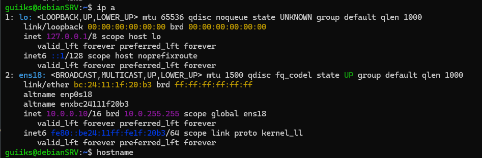
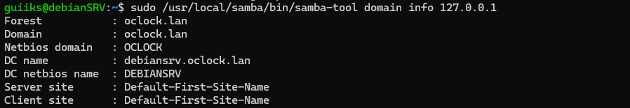
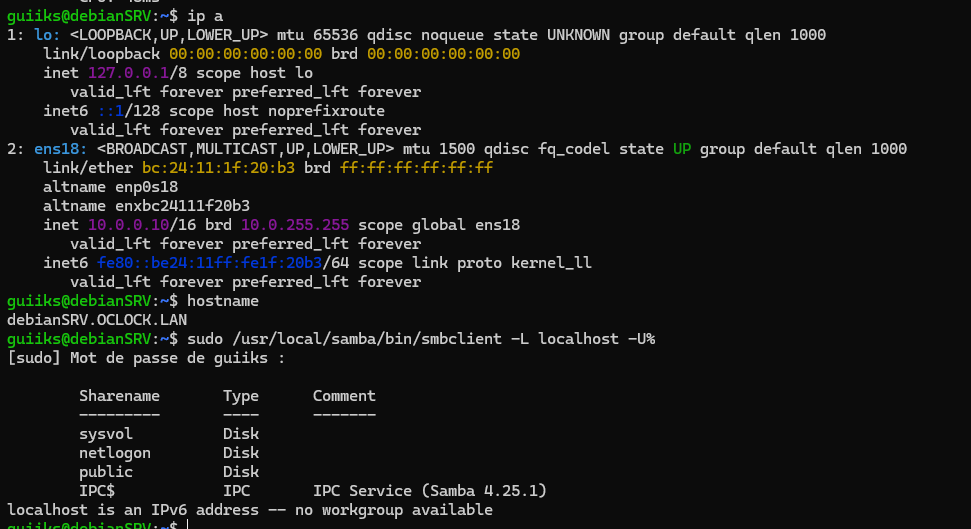
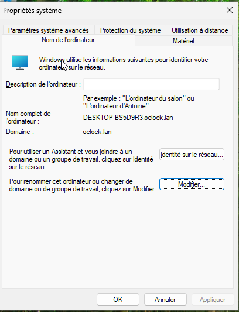
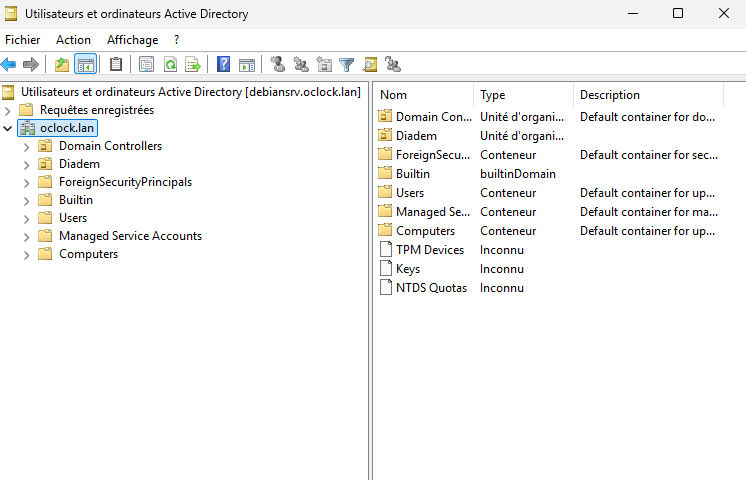
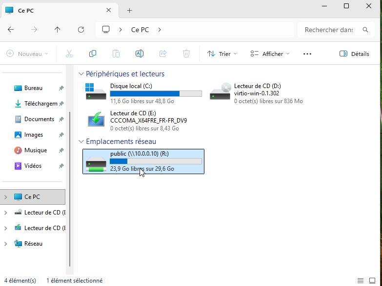

# Atelier Samba 4 --- Déployer un contrôleur de domaine Active Directory sous Debian 12

> **Projet de laboratoire --- Formation AIS**\
> Déploiement d'un contrôleur de domaine Samba 4 sous Debian 12, puis
> intégration et administration d'un poste Windows avec les outils RSAT.


## 1. Présentation

L'objectif de cet atelier est de mettre en place une alternative open
source aux services de domaine Active Directory de Windows Server, en
utilisant **Samba 4** sur **Debian 12**.

Samba 4 permet notamment de fournir des services compatibles avec Active
Directory, dont l'annuaire, l'authentification Kerberos et le DNS
intégré. Un poste Windows peut ensuite rejoindre le domaine et être
administré à l'aide des outils RSAT.

### Objectifs techniques

-   Installer et configurer un serveur Debian 12.
-   Déployer Samba 4 en tant que contrôleur de domaine Active Directory.
-   Configurer les services DNS et Kerberos.
-   Mettre en place la synchronisation horaire.
-   Intégrer un poste Windows au domaine.
-   Utiliser les outils RSAT pour l'administration.
-   Créer un partage de fichiers Samba.
-   Étudier le démarrage du service avec Systemd.

> **Périmètre :** il s'agit d'un atelier pédagogique réalisé en
> environnement de laboratoire. Il ne constitue pas, en l'état, une
> procédure de mise en production.

## 2. Architecture du laboratoire

``` text
                  Domaine : OCLOCK.LAN
                         |
             +-----------+-----------+
             |                       |
      Debian 12 / Samba 4       Poste Windows 10/11 Pro
      debianSRV                 Client du domaine
      10.0.0.10                 DNS : 10.0.0.10
             |                       |
             +---- DNS / Kerberos ---+
                         |
                 Administration RSAT
```

### Paramètres de l'environnement

| Élément | Valeur |
|---|---|
| Système serveur | Debian 12 |
| Rôle | Contrôleur de domaine Samba 4 |
| Nom du serveur | `debianSRV` |
| Domaine DNS / Kerberos | `OCLOCK.LAN` |
| Nom NetBIOS du domaine | `OCLOCK` |
| Adresse IPv4 du serveur | `10.0.0.10` |
| Réseau utilisé dans l'exemple | `10.0.0.0/16` |
| Interface réseau de l'exemple | `ens18` |
| Client | Windows 10/11 Pro |
| Administration | RSAT |

### Ressources de la machine virtuelle

- **RAM :** 4 Go
- **CPU :** 2 vCPU
- **Stockage :** 50 Go
- **Hyperviseur :** Proxmox ou équivalent

Adaptez les ressources et les paramètres réseau à votre environnement.

## 3. Préparation de Debian 12

### 3.1 Installation du système

Installer Debian 12 sans environnement graphique et sélectionner le
serveur SSH.

Paramètres utilisés dans l'atelier :

-   Nom de machine : `debianSRV`
-   Domaine : `OCLOCK.LAN`

**Point de vigilance :** conserver un nom d'hôte court (`debianSRV`) est
généralement préférable pour un contrôleur de domaine Samba AD. Le FQDN
correspondant est `debianSRV.OCLOCK.LAN`. Vérifier la cohérence du nom
d'hôte, du fichier `/etc/hosts` et du provisionnement avant de
poursuivre.

### 3.2 Configuration réseau

Éditer le fichier réseau :

``` bash
sudo nano /etc/network/interfaces
```

Exemple de configuration statique pour une interface `ens18` :

``` ini
allow-hotplug ens18
iface ens18 inet static
  address 10.0.0.10
  netmask 255.255.0.0
  network 10.0.0.0
  broadcast 10.0.255.255
  gateway 10.0.0.1
  dns-nameservers 8.8.8.8
  dns-search OCLOCK.LAN
```

Les valeurs de passerelle et de DNS amont sont des exemples à adapter au
réseau du laboratoire. Pendant la préparation, un DNS amont peut être
utilisé pour résoudre les noms Internet. Une fois le contrôleur de
domaine opérationnel, le serveur et les clients du domaine doivent
utiliser le DNS AD de Samba.

Mettre à jour `/etc/hosts` :

``` text
10.0.0.10    debianSRV.OCLOCK.LAN debianSRV
```

Définir le nom d'hôte court dans `/etc/hostname` :

``` text
debianSRV
```

Redémarrer puis contrôler la configuration :

``` bash
sudo reboot
ip a
hostname
ping -c 4 10.0.0.1
ping -c 4 google.com
```




## 4. Installation de Samba 4

### 4.1 Installation des dépendances

Mettre à jour les dépôts puis installer les dépendances de compilation
indiquées dans l'atelier :

``` bash
sudo apt update
sudo apt install -y build-essential libacl1-dev libattr1-dev libblkid-dev \
libgnutls28-dev libreadline-dev gdb pkg-config libpopt-dev python3-dev \
liblmdb-dev flex bison libgpgme-dev libparse-yapp-perl libjansson-dev \
libarchive-dev libdbus-1-dev
```

### 4.2 Compilation depuis les sources

L'atelier utilise une compilation de Samba depuis les sources :

``` bash
wget https://download.samba.org/pub/samba/samba-latest.tar.gz
tar zxvf samba-latest.tar.gz
cd samba-*
./configure --enable-debug --enable-selftest
make
sudo make install
```

**À savoir :** `samba-latest` désigne une version évolutive. Pour
reproduire exactement le laboratoire plus tard, noter la version
effectivement téléchargée et privilégier une archive de version précise.

### 4.3 Provisionnement du domaine

Supprimer un éventuel fichier de configuration préexistant, puis lancer
le provisionnement :

``` bash
sudo rm -f /usr/local/samba/etc/smb.conf
sudo /usr/local/samba/bin/samba-tool domain provision
```

Pendant l'assistant, renseigner les paramètres du domaine :

-   Realm : `OCLOCK.LAN`
-   Domaine / workgroup : `OCLOCK`
-   Rôle : contrôleur de domaine Active Directory
-   DNS : serveur DNS interne Samba, selon les choix de l'atelier
-   Mot de passe administrateur : choisir un mot de passe robuste et le
    conserver de manière sécurisée.

Ne jamais publier de mot de passe, de secret Kerberos ou de donnée
d'identification dans le dépôt GitHub.




### 4.4 Premier démarrage et vérification des partages système

Démarrer Samba pour le test :

``` bash
sudo /usr/local/samba/sbin/samba
```

Vérifier les partages système :

``` bash
sudo /usr/local/samba/bin/smbclient -L localhost -U%
```

Les partages `netlogon` et `sysvol` doivent être présents sur un
contrôleur de domaine Samba AD correctement provisionné.



## 5. Configuration des services d'infrastructure

### 5.1 DNS et résolution du domaine

Le contrôleur de domaine Samba fournit le DNS utilisé par les machines
membres du domaine.

Exemple de configuration de résolution locale présenté dans l'atelier
(`/etc/resolv.conf`) :

``` text
search OCLOCK.LAN
domain OCLOCK.LAN
nameserver 10.0.0.10
```

> Selon la configuration de Debian, `/etc/resolv.conf` peut être géré
> automatiquement par un autre service. Vérifier son mode de gestion
> avant de le modifier manuellement.

Dans `/usr/local/samba/etc/smb.conf`, l'atelier utilise notamment les
paramètres suivants :

``` ini
[global]
    dns forwarder = 10.0.0.1
    netbios name = DEBIANSRV
    realm = OCLOCK.LAN
    server role = active directory domain controller
    workgroup = OCLOCK

[netlogon]
    path = /usr/local/samba/var/locks/sysvol/oclock.lan/scripts
    read only = No

[sysvol]
    path = /usr/local/samba/var/locks/sysvol
    read only = No
```

Le DNS forwarder (`10.0.0.1`) est un exemple : il doit correspondre à un
résolveur amont accessible depuis le serveur.

### 5.2 Kerberos

Lier le fichier Kerberos fourni par Samba à la configuration système :

``` bash
sudo ln -sf /usr/local/samba/share/setup/krb5.conf /etc/krb5.conf
```

L'atelier présente également la commande suivante pour désactiver
l'expiration du compte administrateur :

``` bash
sudo /usr/local/samba/bin/samba-tool user setexpiry administrator --noexpiry
```

**Sécurité :** cette option supprime l'expiration du mot de passe du
compte concerné. Elle ne doit pas être appliquée automatiquement en
production. Une politique de gestion des comptes et des mots de passe
doit être définie.

### 5.3 Synchronisation horaire NTP

Activer la synchronisation horaire :

``` bash
sudo timedatectl set-ntp true
```

Configurer `/etc/systemd/timesyncd.conf` :

``` ini
[Time]
NTP=10.0.0.1
FallbackNTP=0.fr.pool.ntp.org 1.fr.pool.ntp.org
```

Redémarrer le service :

``` bash
sudo systemctl restart systemd-timesyncd
```

La synchronisation horaire est importante pour Kerberos : un décalage
significatif entre les machines peut provoquer des échecs
d'authentification.

### 5.4 Zone DNS inversée

Créer la zone de recherche inversée correspondant au réseau
`10.0.0.0/16` :

``` bash
sudo /usr/local/samba/bin/samba-tool dns zonecreate debianSRV 0.0.10.in-addr.arpa -U administrator
```

Cette commande est à exécuter avec les droits nécessaires et après
vérification du fonctionnement du DNS Samba.

## 6. Intégration d'un poste Windows

### 6.1 Préparation du client

Sur un poste Windows 10/11 Pro situé sur le même réseau :

1.  Configurer le DNS préféré de la carte réseau sur `10.0.0.10`.
2.  Vérifier que le nom du domaine est résolu.
3.  Rejoindre le domaine `OCLOCK.LAN` avec un compte autorisé.

Exemples de vérifications depuis Windows :

``` powershell
ipconfig /all
nslookup OCLOCK.LAN
ping debianSRV.OCLOCK.LAN
```

La réussite du ping dépend de la configuration du pare-feu ; l'échec du
ping ne suffit donc pas, à lui seul, à conclure à une panne DNS ou AD.



### 6.2 Installation des outils RSAT

Dans PowerShell lancé en tant qu'administrateur :

``` powershell
Add-WindowsCapability -Online -Name "Rsat.ServerManager.Tools~~~~0.0.1.0"
Add-WindowsCapability -Online -Name "Rsat.ActiveDirectory.DS-LDS.Tools~~~~0.0.1.0"
Add-WindowsCapability -Online -Name "Rsat.GroupPolicy.Management.Tools~~~~0.0.1.0"
```

Ouvrir `mmc`, puis ajouter les composants d'administration nécessaires,
notamment :

-   Utilisateurs et ordinateurs Active Directory.
-   Gestion des stratégies de groupe (GPO).

Les outils RSAT permettent d'administrer les services compatibles depuis
le poste Windows ; ils ne remplacent pas le contrôleur de domaine Samba.



## 7. Partage de fichiers Samba

### 7.1 Exemple de partage

L'atelier prévoit un partage nommé `public` dans
`/usr/local/samba/etc/smb.conf`.

**Attention :** les paramètres `guest ok = no` et `guest only = yes`
présents dans la configuration initiale sont contradictoires avec un
partage réservé aux utilisateurs authentifiés. Pour un partage
authentifié, partir plutôt d'une configuration de ce type, puis
l'adapter aux groupes et permissions réellement définis :

``` ini
[public]
    path = /home/shares/public
    guest ok = no
    read only = no
    browseable = yes
    create mask = 0660
    directory mask = 0770
```

Créer le répertoire :

``` bash
sudo mkdir -p /home/shares/public
```

Les droits Unix et les droits Samba doivent être cohérents. Il faut
définir le propriétaire et le groupe adaptés au besoin, puis attribuer
les permissions minimales nécessaires.

> **Sécurité :** la commande `chmod 777` figurant dans les notes
> initiales donne les droits de lecture, écriture et exécution à tous
> les utilisateurs locaux. Elle est à éviter pour un partage réel. Ne
> l'utilisez pas comme recommandation de sécurité.



## 8. Automatisation avec Systemd

L'atelier propose de créer une unité Systemd pour démarrer Samba
automatiquement.

Créer le fichier :

``` bash
sudo nano /etc/systemd/system/samba-ad-dc.service
```

Exemple d'unité issu de l'atelier :

``` ini
[Unit]
Description=Samba Active Directory Domain Controller
After=network.target remote-fs.target nss-lookup.target time-sync.target

[Service]
Type=forking
ExecStart=/usr/local/samba/sbin/samba
Restart=on-failure
RestartSec=10

[Install]
WantedBy=multi-user.target
```

Recharger Systemd et activer le service :

``` bash
sudo systemctl daemon-reload
sudo systemctl enable samba-ad-dc.service
sudo systemctl start samba-ad-dc.service
sudo systemctl status samba-ad-dc.service
```

**Point de validation :** vérifier le comportement réel du service après
redémarrage, notamment son état, ses journaux et l'absence d'un second
processus Samba lancé manuellement. La définition d'une unité Systemd
doit être validée sur la version et le mode d'installation effectivement
utilisés.

## 9. Difficultés et points de vigilance

Les points suivants méritent une attention particulière lors d'un
déploiement Samba AD :

-   La configuration DNS doit être cohérente sur le contrôleur de
    domaine et les clients.
-   Kerberos dépend d'une synchronisation horaire correcte.
-   Les noms d'hôte, le realm Kerberos et le nom du domaine doivent être
    cohérents.
-   Les permissions Unix et les paramètres de partage Samba doivent être
    définis ensemble.
-   Les comptes et mots de passe d'administration doivent être protégés.
-   Les règles de pare-feu doivent autoriser uniquement les flux
    nécessaires.
-   Une configuration fonctionnelle en laboratoire doit être revue avant
    toute utilisation en production.

## 10. Compétences mobilisées

-   Administration d'un serveur Linux Debian 12.
-   Configuration réseau IPv4 et résolution DNS.
-   Installation et compilation d'un service depuis les sources.
-   Déploiement d'un contrôleur de domaine Samba 4.
-   Notions d'Active Directory et d'authentification Kerberos.
-   Intégration d'un poste Windows dans un domaine.
-   Administration avec RSAT.
-   Création et gestion de partages réseau.
-   Gestion des permissions Linux et Samba.
-   Automatisation de services avec Systemd.

## 11. Bilan

Cet atelier m'a permis d'étudier le déploiement d'un contrôleur de
domaine Samba 4 sous Debian 12 et son interopérabilité avec un poste
Windows.

Il met en pratique plusieurs briques fondamentales de l'administration
systèmes : Linux, DNS, Kerberos, services de domaine, partages réseau et
administration Windows.
